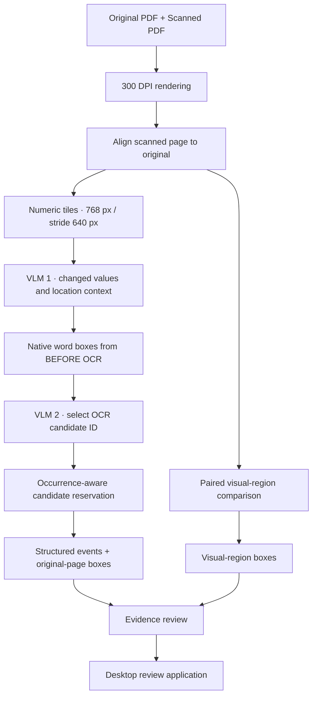
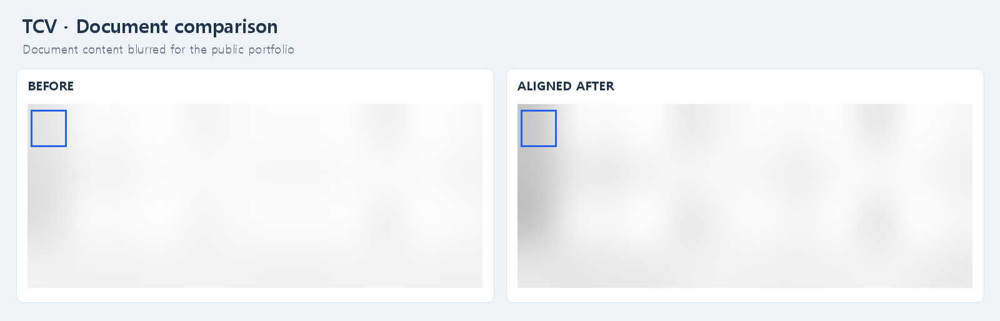
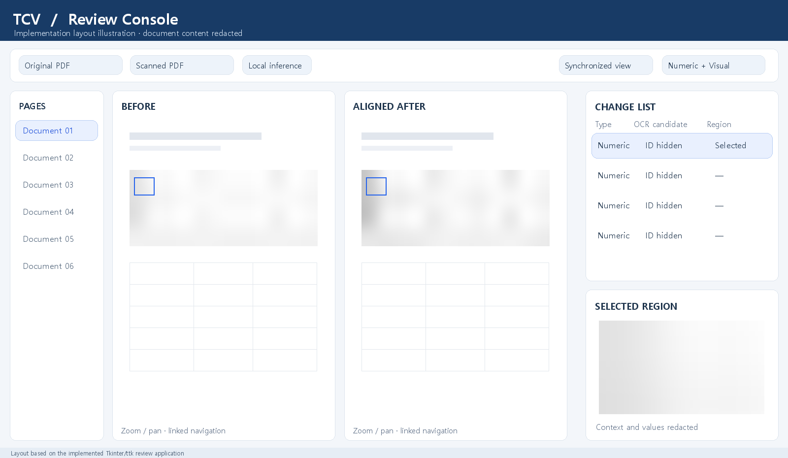

# TCV · Test Certificate Verification

### VLM-Guided Numeric Change Localization

시험성적서 원본 PDF와 스캔본을 비교해 수치 변경을 찾고, 해당 위치를 원본 문서의 OCR 박스로 연결하는 문서 검토 시스템입니다. 반복되는 숫자가 많은 표에서도 변경값과 주변 설명을 함께 사용해 실제 문서 위치를 선택하도록 구성했습니다.

**Python · Qwen3-VL 32B · PaddleOCR · OpenCV · Tkinter**

## Overview

TCV는 문서 비교를 세 가지 작업으로 구성합니다.

- **변경 검출** — 원본과 정합된 스캔본을 비교해 변경 전 값, 변경 후 값, 위치 설명을 구조화합니다.
- **위치 선택** — VLM이 기존 OCR 후보 중 해당 변경을 가리키는 ID를 선택하고 원본 좌표를 결과에 연결합니다.
- **근거 검토** — 데스크톱 검토 화면에서 문서 쌍, 변경 목록, 선택 영역을 함께 확인합니다.

그림과 도식은 별도의 시각 비교 경로에서 대응 영역을 검토합니다. 수치 위치 선택에는 OCR의 원래 박스를 사용합니다.

## Architecture

| Component | Implementation |
|---|---|
| PDF processing | 300 DPI 렌더링과 같은 페이지 번호의 문서 쌍 비교 |
| Geometric alignment | ORB 특징점과 RANSAC 기반 변환으로 스캔본을 원본 좌표계에 정합 |
| Numeric detection | Qwen3-VL 32B가 변경 전후 값과 위치 설명을 JSON으로 반환 |
| OCR grounding | PaddleOCR의 native word box에 후보 ID를 부여하고 VLM이 선택 |
| Repeated values | 물리적으로 다른 숫자 위치를 별도 이벤트로 취급하고, 선택 후보 예약을 통해 타일 내부 중복 선택을 관리 |
| Visual comparison | 좌우 문서의 대응 시각 영역을 비교하고 시각 영역 bbox를 결과로 연결 |
| Review application | Tkinter/ttk 기반 문서 탐색, 나란히 보기, 확대·이동, 변경 목록과 선택 영역 미리보기 |
| Execution evidence | 요청·응답·OCR 후보·선택 좌표와 입력 SHA를 실행별로 보존 |

## Engineering Highlights

### Detection and localization as separate model tasks

1차 모델은 변경 내용에 집중하고, 2차 모델은 이미 보고된 변경의 위치 선택에 집중합니다. 두 단계 사이에는 변경 전 값·변경 후 값·자연어 설명을 전달합니다.

### Native OCR coordinates

위치 결과는 OCR 후보 ID를 통해 원본 문서 좌표에 연결합니다. 후보 선택을 구조화된 출력으로 제한해, 검토자가 모델 설명과 문서의 선택 영역을 함께 확인할 수 있습니다.

### Local inference

Qwen3-VL 32B는 로컬 Ollama 서버에서 실행하고 OCR도 로컬에서 처리합니다. PDF 렌더링, 정합, 모델 추론, 근거 검토를 데스크톱 환경에서 수행하도록 구성했습니다.

### Traceable results

이벤트별 수치·설명·후보 ID·bbox를 보존합니다. 입력 문서 SHA와 실행별 산출물을 함께 관리해 검토 결과의 출처를 추적할 수 있습니다.

## Reference Evaluation

| Item | Result |
|---|---:|
| 처리한 문서 쌍 | 59페이지 |
| GT 검수 완료 페이지 | 58페이지 |
| 검수된 수치 변경 위치 | 91개 |
| 선택된 bbox가 포함한 검수 위치 | **91 / 91** |
| 검수 위치 커버리지 | **100%** |
| VLM | Qwen3-VL 32B |

평가 대상은 같은 원본·스캔본 문서 쌍의 검수된 위치입니다. 수치는 **공간 위치 커버리지**를 나타내며, 이벤트 설명과 행의 일치 여부는 별도의 검토 항목입니다. GT는 사후 채점에 사용합니다.

## Document Comparison

공개 예시에는 문서 내용을 가린 비교 영역을 사용했습니다.

## Desktop Review

왼쪽 페이지 탐색, 가운데 원본·정합 스캔본, 오른쪽 변경 목록·선택 영역으로 구성했습니다. 아래 이미지는 구현된 Tkinter/ttk 화면 구조를 바탕으로 만든 **구성도**입니다. 문서 내용과 이벤트 값은 가렸습니다.

| Review interaction | Purpose |
|---|---|
| 페이지·변경 유형 탐색 | 검토할 문서와 수치·시각 변경을 선택 |
| 원본·정합 스캔본 동시 보기 | 같은 위치의 내용을 나란히 확인 |
| 확대·이동과 연결된 화면 탐색 | 작은 숫자와 주변 표 구조를 확인 |
| 이벤트 목록과 영역 미리보기 | 선택한 변경의 설명과 해당 영역을 확인 |

## Technology

| Layer | Tools |
|---|---|
| Language | Python |
| Multimodal inference | Qwen3-VL 32B, Ollama |
| OCR | PaddleOCR |
| Image processing | OpenCV, NumPy, Pillow |
| Desktop UI | Tkinter, ttk |
| Result contracts | JSON, candidate IDs, page-coordinate bounding boxes |

## Public Materials

이 저장소는 프로젝트의 시스템 설계와 구현 결과를 소개하는 포트폴리오입니다. 공개 자료에는 설명 문서와 내용이 가려진 예시 이미지를 담았습니다.
